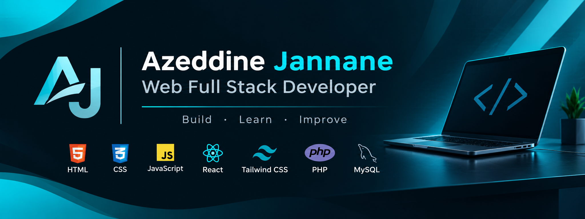

  

# Azeddine Jannane

### Web Full Stack Developer

Web Full Stack Development student at **CMC (OFPPT), Morocco**, interested in building modern, responsive, and functional web applications.

I enjoy exploring new technologies, solving development challenges, and transforming ideas into practical digital solutions.

---

## About Me

- Web Full Stack Development student at CMC.
- Focused on frontend and backend web development.
- Interested in software engineering and modern web technologies.
- Building practical projects to strengthen my development skills.
- Continuously learning and improving through hands-on experience.

---

## Technical Skills

**Frontend Development**

**Backend Development & Database**

**Development Tools**

---

## Featured Project

### SYF — Simple File Transfer

A full-stack web application designed to make file sharing simple and accessible without requiring user accounts.

**Key Features**
- Multiple file uploads
- Unique sharing codes
- QR code generation
- Optional password protection
- Automatic file expiration
- Responsive user interface

**Technologies:** React, JavaScript, Vite, Tailwind CSS, PHP, MySQL.

[Live Demo](https://syf.site.je) · [Source Code](https://github.com/azadinjn/SYF)

---

## Currently Learning

- Advanced JavaScript
- React development
- Backend development with PHP
- Database design and management
- Software development best practices

---

## Connect

[LinkedIn](https://www.linkedin.com/in/azeddine-jannane-a709243a0/) · [GitHub](https://github.com/azadinjn)

---

  Building, learning, and improving through code.

